<div align="center">

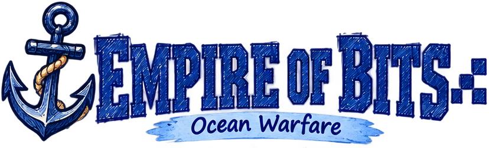

**Naval battle drawn in ballpoint pen on graph paper, played for real on Solana.**

Place your fleet, buy an arsenal, and sink your rival in fast ranked matches.
A server referees every shot. Stake points on a match, then trade them for SOL.


[Website](https://empireofbits.xyz) · [Launch trailer](#-launch-trailer-and-launch-film) · [How to play](#-how-to-play) · [Economy](#-the-economy) · [Run it yourself](#-getting-started) · [Contribute](#-contributing)

</div>

---

## 🎬 Launch trailer and launch film

<table>
<tr>
<td width="50%" align="center" valign="top">
<a href="demo-assets/battleship-demo-video/out/empire-of-bits-demo-v2-1080p.mp4">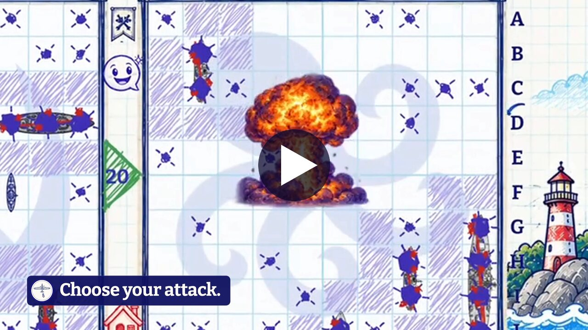</a>
<br><b>Launch trailer</b> · 0:15 · 4K at 60 fps
<br><a href="demo-assets/battleship-demo-video/out/empire-of-bits-demo-v2-1080p.mp4">1080p</a> · <a href="demo-assets/battleship-demo-video/out/empire-of-bits-demo-v2-4k.mp4">4K</a>
</td>
<td width="50%" align="center" valign="top">
<a href="launch-film/deliverables/EmpireOfBits_LaunchFilm_1080p.mp4">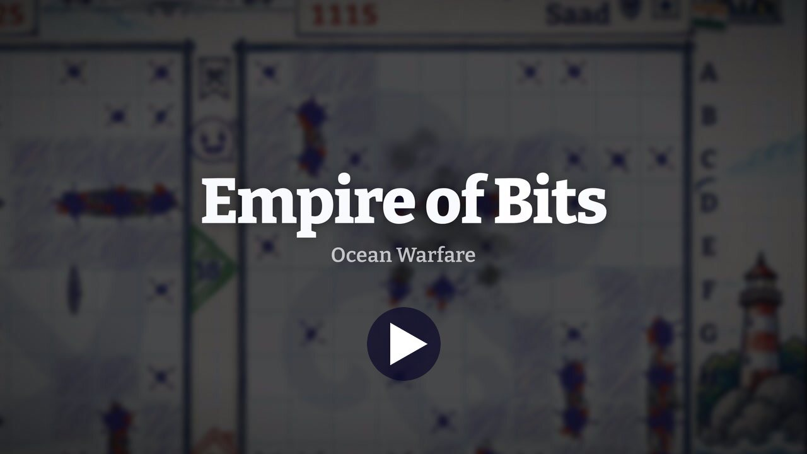</a>
<br><b>Launch film</b> · 1:54 · 1080p at 30 fps
<br><a href="launch-film/deliverables/EmpireOfBits_LaunchFilm_1080p.mp4">1080p</a> · <a href="launch-film/deliverables/poster.jpg">4K poster</a>
</td>
</tr>
</table>

<!--
  To get inline players on GitHub: edit this file in the GitHub web editor, drag each MP4
  onto the editor, and paste the user-attachments URL it gives you on its own line.
  GitHub only plays videos hosted there, not MP4s linked from the repository.
-->

Both videos were made entirely in code with [Remotion](https://www.remotion.dev/), from real
gameplay recordings and the game's own art, music and sound effects. Every name and number on
screen comes from the game's code.

### The launch trailer: 15 seconds

`demo-assets/battleship-demo-video/` is a Remotion 4 project: 3840×2160, 60 fps, 900 frames.
Version 2 (`src/v2/`) is "the board becomes a world". The gameplay runs full-bleed, the board's
lighthouse opens into a layered Port City, and a battleship wipe cuts back into the raid.

| Time | Caption | Footage |
|---|---|---|
| 0:00–0:03 | *Choose your attack.* | The Atomic Bomber's 3×3 strike |
| 0:03–0:06 | *Build your defense.* | An AA gun shoots a bomber down: "Shot down!" |
| 0:06–0:08.5 | *Your home port.* | The Port City, rebuilt from the game's layout data |
| 0:08.5–0:13 | *Take the fight to them.* | A bomber run, the last ship sinks, Victory |
| 0:13–0:15 | End card | Solana dApp Store badge and `empireofbits.xyz` |

```bash
cd demo-assets/battleship-demo-video
npm install
npm run studio       # live preview in Remotion Studio
npm run render:v2    # out/empire-of-bits-demo-v2-{4k,1080p}.mp4
npm run verify:v2    # checks frames, fps, duration, codecs, fast start
```

All editable values (trims, camera keyframes, captions, sound cues) live in `src/v2/configV2.ts`.
See [its README](demo-assets/battleship-demo-video/README.md).

### The launch film: 1 minute 54 seconds

`launch-film/` is a second Remotion project, made to the brief in
[launch-film/BRIEF.md](launch-film/BRIEF.md): an Apple-keynote-style product film with no
voiceover, carried by kinetic type, the game's music and frame-accurate sound design. The
signature motif is **the bit**, a single glowing pixel. It opens the film, becomes the period in
"…a single bit.", and pings once more as the period in "Your move."

| # | Time | Section | What you see |
|---|---|---|---|
| 1 | 0:00 | Cold open | A pixel in the dark pings like sonar and draws the graph-paper grid. *"Every empire starts with a single bit."* |
| 2 | 0:08 | Title | A hard cut on the atomic strike, then **Empire of Bits · Ocean Warfare**. *"Command the sea."* |
| 3 | 0:14 | Wallet | The embedded Solana wallet. *"Connect. You're in."* |
| 4 | 0:18 | Build your base | Placement, then an AA gun and a mine go down. *"Position is everything."* |
| 5 | 0:30 | Meet the fleet | Battleship, Cruiser, Destroyer and Patrol Boat in a lineup. *"8 ships."* |
| 6 | 0:36 | Arsenal | A weapon carousel that settles on the Atomic Bomber |
| 7 | 0:42 | Matchmaking | A radar sweep, then a punch into the VS screen. *"Find your rival."* |
| 8 | 0:46 | Battle | The drop. *"Aim." "Fire." "Hit."*, a montage, then the last ship. *"Every move matters."* |
| 9 | 1:14 | Victory | The result screen as the points count in |
| 10 | 1:20 | Rhythm run | *"Buy points." "Sell points." "Collect every colour." "Climb the ranks."* |
| 11 | 1:32 | Bento recap | Ten tiles, then the camera flies into the battle |
| 12 | 1:38 | Supercut | One beat per moment, ending on the biggest explosion |
| 13 | 1:44 | Finale | *"One more thing."*, the Solana dApp Store badge, *"Your move."* |

The specs, measured by `tools/report.py`: 3840×2160 master plus a 1920×1080 web cut, 30 fps,
H.264 and AAC at 48 kHz, −14.0 LUFS integrated, −1.6 dBTP true peak. The music is the game's
own menu and battle themes, re-arranged bar by bar to a 120 BPM grid by
`audio/score_game.py`. The game's SFX play the drum kit: the mine is the kick and the
explosion is the snare. Wallet addresses, QR codes and transaction signatures are blurred
at the source.

```bash
cd launch-film
npm install
npm run assets    # stage game art and fonts, prepare clips (CFR 30, blurs)
npm run audio     # timeline → score → beat detection → sound design and mix
npm run final     # 4K render → two-pass loudnorm → 4K + 1080p, poster, thumbnail, report
npm run studio    # live preview while editing
```

The copy lives in `src/config/copy.ts`; timing, in beats, lives in `src/config/timeline.ts`.
Change the BPM and every cut moves with it. The 4K master is 512 MB, which is over GitHub's
file limit, so only the 1080p cut is committed. `npm run final` rebuilds the 4K. See
[EDIT_NOTES.md](launch-film/EDIT_NOTES.md), the shot-by-shot
[STORYBOARD.md](launch-film/review/STORYBOARD.md), and the review rounds in
[REVIEW.md](launch-film/REVIEW.md).

---

## 📸 Screenshots

| | |
|---|---|
| 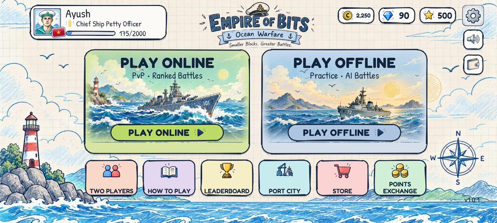 | 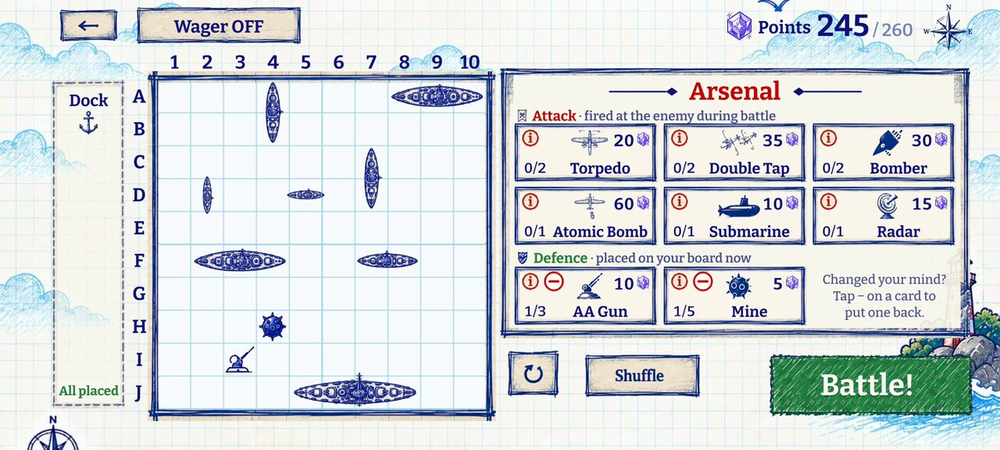 |
| **Main menu.** Play online or offline, plus six tiles. | **Placement.** Drag the fleet, buy the arsenal, plant AA guns and mines. |
| 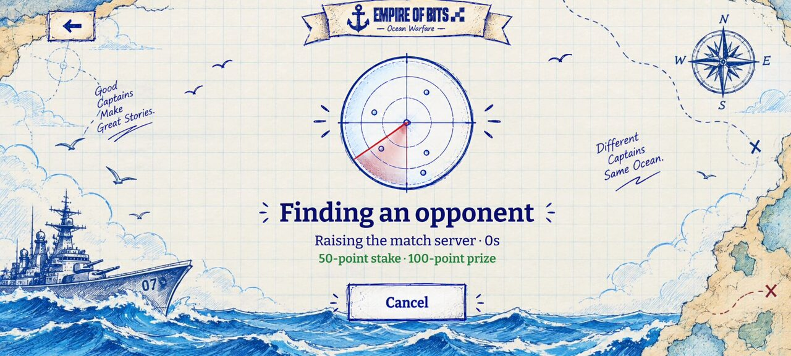 | 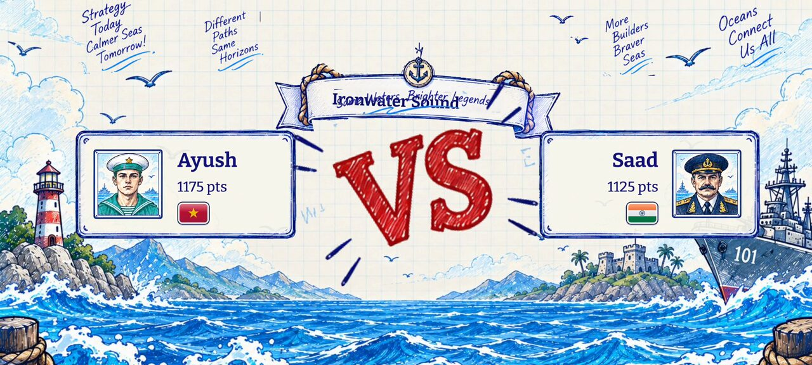 |
| **Matchmaking.** A wagered queue: 50-point stake, 100-point prize. | **Matched.** Both captains, their ranks and their flags. |
| 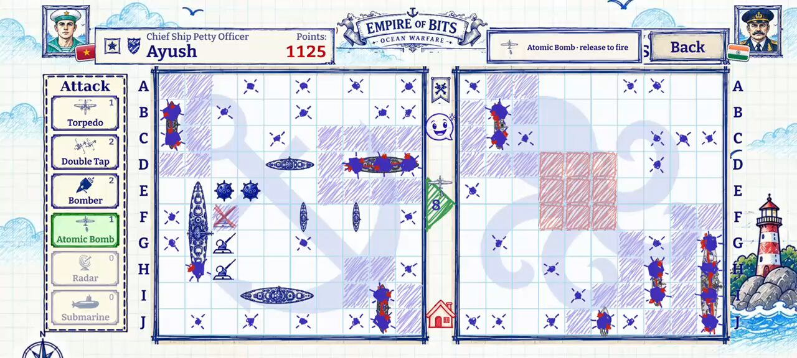 | 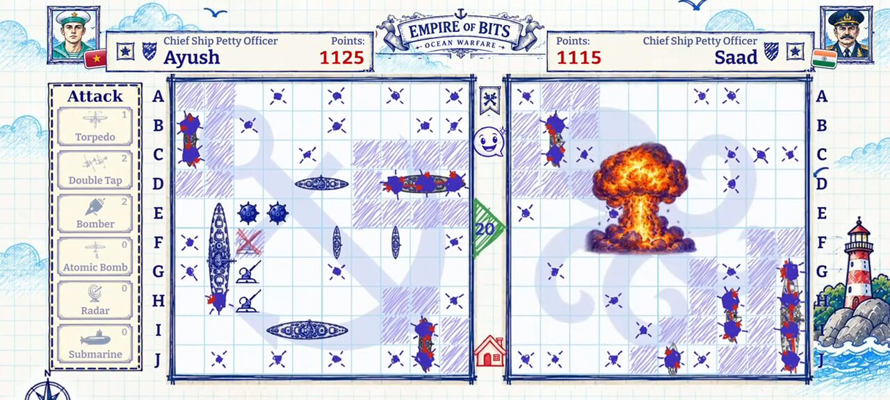 |
| **Aim.** The Attack deck on the left; the 3×3 target preview. | **Hit.** The Atomic Bomber destroys every cell in a 3×3. |
| 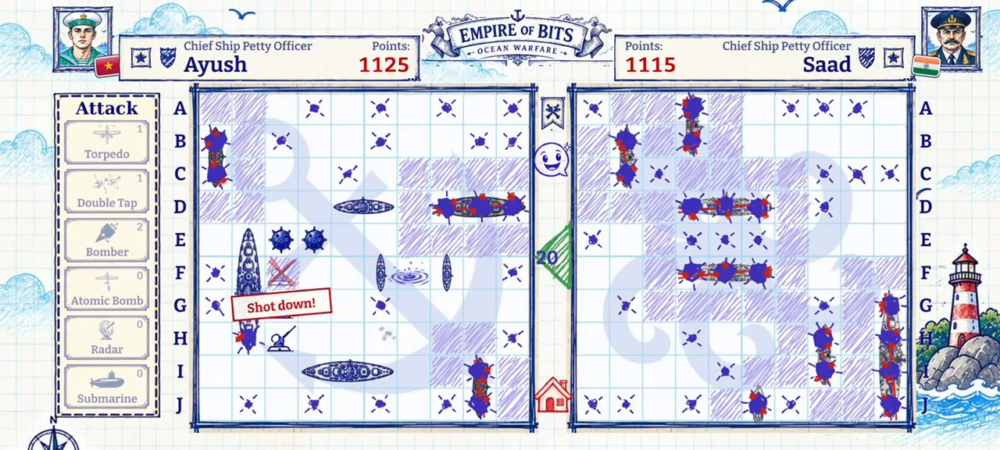 | 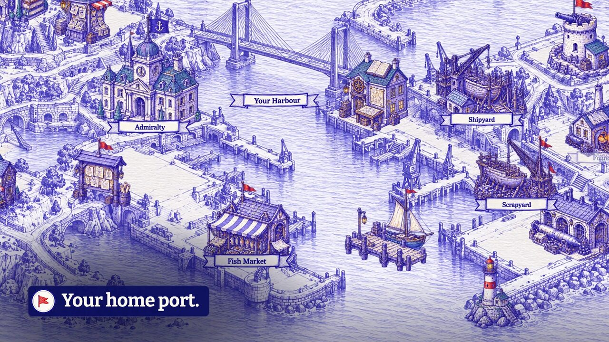 |
| **Defend.** An AA gun voids any aircraft crossing its row. | **Port City.** A pannable, zoomable harbour (preview). |
| 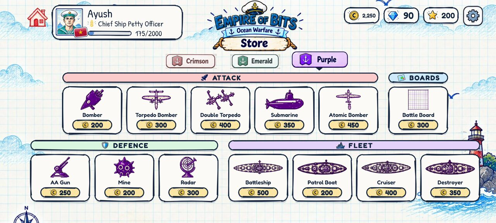 | 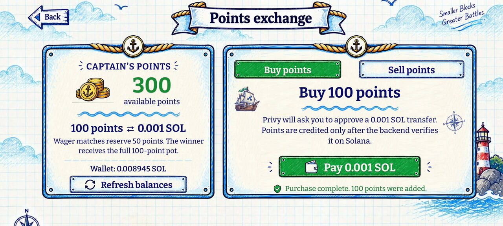 |
| **Store.** Spend coins on Crimson, Emerald and Purple editions. | **Points exchange.** 100 points ⇄ 0.001 SOL, verified on-chain. |
| 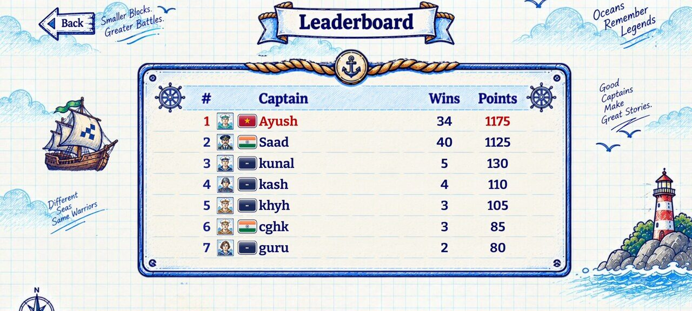 | |
| **Leaderboard.** The ranked ladder, with you bracketed. | |

---

## Contents

- [What it is](#what-it-is)
- [⚓ How to play](#-how-to-play): fleet, placement, shots, arsenal, modes, AI, ranks
- [💰 The economy](#-the-economy): coins, rank points, Solana points, wagers, the store
- [🏗 Architecture](#-architecture)
- [🧰 Tech stack](#-tech-stack)
- [📁 File structure](#-file-structure)
- [🚀 Getting started](#-getting-started)
- [✅ Tests and checks](#-tests-and-checks)
- [📦 Deployment and releases](#-deployment-and-releases)
- [🔐 Security model](#-security-model)
- [📚 Documentation map](#-documentation-map)
- [🤝 Contributing](#-contributing)
- [📄 License and credits](#-license-and-credits)

---

## What it is

**Empire of Bits: Ocean Warfare** is a landscape mobile game for Android, built with Expo and
React Native. It is classic Battleship with the house rules that make it fast and swingy:
ships can't touch, a sunk ship reveals the water around it, and any hit earns another shot.
On top sits an **arsenal** of bombers, a submarine, radar, AA guns and mines.

What makes it more than a clone:

- **A real referee.** Battleship is a hidden-information game. An authoritative Node server
  holds both boards and sends each player only a *masked view*. The client can't cheat,
  because it never has the enemy's board.
- **One rules engine everywhere.** `src/engine/` is pure TypeScript. The same reducer runs
  offline AI games on the phone, live matches on the server, and the tests.
- **On-chain value, server-verified.** Sign in with Google, email or a Solana wallet (through
  Privy). Every player gets an embedded Solana wallet. Points trade at a fixed 100 points ⇄
  0.001 SOL. The server credits a purchase only after it finds the transfer on-chain, and
  signs payouts from a treasury.
- **Hand-drawn, deterministically.** Every border, button and hatch is Rough.js with a
  stable seed, so the "pen" wobbles the same way on every render. Every screen is laid out on
  one fixed 800×360 canvas and scaled to fit the device.

---

## ⚓ How to play

### The board and the fleet

Each captain has a **10×10** grid: rows A–J, columns 1–10. Your fleet is **8 ships covering 18
cells** (`src/engine/fleet.ts`):

| Ship | Length | Count | Cells |
|---|---|---|---|
| Battleship | 4 | 1 | 4 |
| Cruiser | 3 | 2 | 6 |
| Destroyer | 2 | 3 | 6 |
| Patrol Boat | 1 | 2 | 2 |
| **Total** | | **8** | **18** |

That is the classic ten-ship fleet minus two of the four one-cell boats, which made placement
fiddly and added little.

### Placement

1. Ships sit horizontally or vertically, fully inside the grid.
2. **No touching, not even diagonally.** Every ship carries an invisible one-cell halo.
3. Arsenal items you plant (AA guns and mines) take one empty cell each and are **exempt** from
   the halo: they may sit right next to your ships.

On the placement screen you drag ships from the dock. A ship turns red before you let go if
the spot is illegal, because the engine validates every candidate cell. Tap a ship to rotate
it, **Shuffle** for a random legal layout, or **Reset**.

### Taking shots

The rules are in `src/engine/shots.ts`:

```
fire at a cell:
  already shot          → rejected; your turn is NOT used up
  holds a MINE          → mine goes off and is used up; your turn ENDS at once
  holds part of a ship  → HIT, and you KEEP the turn
                          if that was the ship's last cell: SUNK, and every cell
                          touching the whole ship is revealed as water
  otherwise             → MISS; your turn ends
```

- **Win** by sinking all 8 enemy ships. Arsenal items never count toward the win.
- **Turn timer: 20 seconds**, counted down in the turn triangle. Two timeouts in a row
  forfeit the match. A real action resets the count.
- **First turn** goes to the winner of a coin flip seeded from the match seed.
- You can **resign** at any time.
- An AA gun hit by normal fire is destroyed, and the hit keeps your turn.

### The arsenal (advanced rules)

Before the battle you get a **fuel budget of 260** to spend in the arsenal shop on the
placement screen (`src/engine/arsenal.ts`):

| Item | Fuel | Max | Where it goes | Effect |
|---|---|---|---|---|
| Torpedo Bomber ✈ | 20 | 2 | Attack deck | Pick a row. The torpedo runs from column 1 and hits the first intact ship cell. |
| Double Torpedo Bomber ✈ | 35 | 2 | Attack deck | Two torpedoes down two adjacent rows. |
| Bomber ✈ | 30 | 2 | Attack deck | Bombs the target, the cell to its right and the cell below it. |
| Atomic Bomber ✈ | 60 | 1 | Attack deck | Destroys every cell in the 3×3 around the target. |
| Submarine | 10 | 1 | Attack deck | Surfaces on a cell you haven't marked and fires one torpedo up and one down. Each runs until it hits a ship or leaves the grid. |
| Radar | 15 | 1 | Attack deck | Pick a 3×3 on the enemy board. It tells you **how many** ship cells are inside, never which ones. |
| AA Gun | 10 | 3 | Your board | Shoots down any enemy aircraft whose attack crosses its **row**. |
| Mine | 5 | 5 | Your board | The enemy's turn ends the moment they hit it. |

How the arsenal resolves:

- **The aircraft rule.** Every bomber (✈) is an aircraft. Before the attack lands, the engine
  checks every row it covers for an AA gun. The covered rows are the torpedo row, both rows
  of a double, the two rows of a bomber's footprint, and the three rows of an atomic blast.
  If a gun is there, the plane is shot down: the weapon is spent, the gun is revealed, your
  turn ends, and nothing else resolves.
- **Turn effect.** An arsenal attack that lands at least one hit keeps your turn. One that
  hits nothing ends it. Radar never hits, so it always ends your turn.
- **Bombs** resolve each cell in their footprint like a normal shot and skip cells already
  marked. If a bomb sets off a mine, the turn ends, even if the same drop scored hits.
- **Torpedoes** pass over wrecks, mines and guns, and strike the first *intact* ship cell, so
  a torpedo is never wasted on a wreck.
- Your **Attack deck** stays on the left of the battle sheet. Tap a card to arm it, then tap
  the enemy board to aim.

Wherever the original spec was silent, the decision is written in the header comment of the
engine module that makes it.

### Game modes

| Mode | Where | Opponent | Counts toward the ladder? |
|---|---|---|---|
| **Play online** | Menu → Play Online | A human, matched by rank. The server bot steps in after 45 s. | ✅ rank points and coins |
| **Play online, wagered** | Turn on "Wager ON · 50 P" during placement | As above, with 50 points staked | ✅ plus the pot |
| **Play offline** | Menu → Play Offline | On-device AI: Easy, Normal or Hard | Coins only |
| **Two players** | Menu → Two Players | Hot-seat: two captains share one phone | Coins only |
| **Tutorial** | First launch, or How to Play | A scripted match on the real battle screens | No |

The menus start matches on the **advanced** rules. The engine, protocol and server also
support a **classic** ruleset, which is the fleet only with no arsenal.

**Two players (hot-seat).** Both captains type their names and place their fleets in turn.
When the turn changes hands, a sheet covers the incoming player's own board, and one tap lifts
it. There's no modal between turns.

**How to Play** is a swipeable illustrated guide. The **tutorial** is the real battle and
placement screens with a guide overlay on top, so it can never drift from the game.

### The offline AI

`src/engine/ai.ts` only sees a `PlayerView`, the same masked view a human gets.

- **Hunt.** It fires on a checkerboard lattice, weighted toward cells surrounded by open water.
- **Target.** After a hit it tries the four neighbours. Once two hits line up, it follows that
  axis.
- **Easy** adds a 35% chance of a random shot. **Hard** also skips cells the no-touching rule
  proves empty: the cells around sunk ships, and the diagonals of every hit.
- In advanced games it spends its arsenal when there's a good target: the atomic bomber on
  the densest unknown 3×3, torpedoes on mostly-unknown rows, never a row it knows a gun covers.
- It waits 900–1400 ms before each move, so it feels like an opponent rather than a script.

### Online matches

```
placement → queue → matched → both fleets in → 2 s arena reveal → battle → reveal → result
```

- **Matchmaking** (`server/src/matchmaker.ts`) keeps separate queues for normal and wagered
  play. You're matched with captains within **±150 rank points**. The window widens by 150
  every 5 s and drops the limit entirely after 30 s. After **45 s** with no human, the
  server's own bot takes the seat.
- **Deadlines.** Each player has 90 s to submit a layout. A dropped connection has a 45 s grace
  to reconnect. The client reconnects with backoff and resumes the match by its id.
- **The loser sees the winner's base.** For 5 seconds the losing captain sees the winner's
  final board, then the result.
- **Emotes** ride the match socket: quick reactions that rise over the sheet.
- **Never predicted.** When you fire online, the shell flies at once, but the verdict waits for
  the server. Until it arrives, the cell shows an ink "…".

### Ranks

Six ranks with cumulative thresholds (`src/engine/ranks.ts`, mirrored by
`supabase/migrations/0003_ranks.sql`; a test pins the two together):

| Rank | Rank points |
|---|---|
| Seaman Recruit | 0 |
| Seaman Apprentice | 100 |
| Petty Officer Second Class | 400 |
| Chief Ship Petty Officer | 1,000 |
| Captain | 3,000 |
| Vice-admiral | 10,000 |

### The Port City

The **Port City** is a hand-drawn harbour you can pan and zoom, with fifteen buildings: the
Admiralty, Shipyard, Lighthouse, Naval Academy, Fleet Tavern, Gazette, Captain's Log and more.
It's a **preview**. You explore it, then a "coming soon" panel appears. There's no building
system or purchase yet.

---

## 💰 The economy

The game has three currencies, and each has one job:

| Currency | What it is | How you get it | What it's for | Who owns the number |
|---|---|---|---|---|
| ⭐ **Rank points** | Your place on the ladder | Online matches only | Rank and leaderboard | The match server, settled in Postgres |
| 🪙 **Coins** | Soft currency | Every match, online or offline | The cosmetic store | The server (earned) and the device (spent) |
| 💎 **Points** | The Solana-backed currency | 100 welcome points, buying with SOL, winning wagers | Wagers; selling for SOL | Server-side ledger, one per verified Privy identity |

The profile also has a **gems** balance, shown on the menu. Nothing awards or spends gems yet.

### Match rewards

One constant drives every payout, `REWARD` in `src/engine/ranks.ts`. The database never
hard-codes these numbers.

| Result | Online (human or server bot) | Offline AI or hot-seat |
|---|---|---|
| **Win** | +25 rank points, +50 coins | +50 coins |
| **Loss** | +5 rank points, +10 coins | +10 coins |

**Only matches the server saw count toward the ladder.** An offline result is reported by the
phone itself, so it can't be trusted with anything the leaderboard ranks by. Offline results
pay coins only, through `apply_offline_result`. Online results are settled by
`apply_match_result` in **one atomic, idempotent transaction**: it closes the match, moves
both captains' rank points, coins and win counts, and settles any wager.

### The store (coins)

Coins buy an item's **Crimson**, **Emerald** or **Purple** edition: 13 items × 3 colours = 39
collectibles (`src/features/store/catalog.ts`).

| Section | Items (price in coins) |
|---|---|
| Attack | Bomber 200 · Torpedo Bomber 300 · Double Torpedo 400 · Submarine 350 · Atomic Bomber 450 |
| Boards | Battle Board 300 |
| Defence | AA Gun 250 · Mine 200 · Radar 300 |
| Fleet | Battleship 500 · Patrol Boat 200 · Cruiser 400 · Destroyer 350 |

Editions are **for the collection only**. Nothing in a match reads what you bought, so the
store sells no gameplay advantage. Purchases are recorded on the device, per account. The
balance on screen is coins earned minus coins spent.

### Points and SOL

Points are the currency with real value, so the server does all the arithmetic and the app
never writes a balance. Every change is a row in the append-only `point_ledger`, with one of
the reasons `welcome`, `wager_entry`, `wager_refund`, `wager_prize`, `buy`, `sell_reserve` or
`sell_refund`.

| Rule | Value |
|---|---|
| Exchange rate | **100 points ⇄ 0.001 SOL** (1,000,000 lamports), fixed, the same in both directions |
| Trade size | Exactly 100 points per buy or sell |
| Welcome bonus | **100 points**, once per verified Privy identity (reinstalling can't farm it) |
| Welcome points | **Locked**: you can stake them and win with them, but never sell them |
| Wager stake | **50 points** per player; the winner takes the **100-point pot** |
| Network | Solana **mainnet-beta**; native SOL, no token mint |
| Buy order lifetime | 10 minutes |

#### Buying points

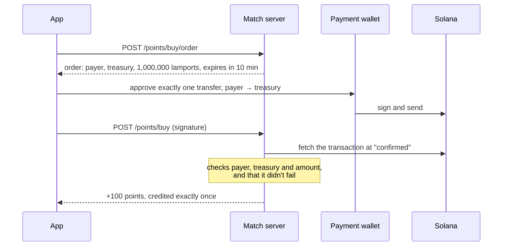

A signature on its own proves nothing, and a "success" from the client never credits. The
order and the signature can each credit only once. If the app crashes after paying, **Finish
credit** asks the server to find the payment on-chain (`/points/buy/reconcile`). It never asks
you to pay again.

#### Selling points

The server reserves 100 *sellable* points and fixes the destination: your payment wallet at
that moment. The treasury then signs a 0.001 SOL transfer to it, and the treasury pays the
network fee. The signed transaction is stored before it's broadcast, so a retry re-sends that
same transaction and never signs a second one. Points come back only if the payout definitely
failed.

#### Wagers

```
toggle "Wager ON · 50 P" → 50 points held in Postgres → queue (wager pool)
   ├─ leave before a room exists → stake refunded atomically
   └─ match played on the server → settled in the same transaction as the result:
                                    the winner receives 100 points
```

- Wagers are **online only**. A stake rides only on a match the server runs from start to
  finish, against a human or the server's bot. An offline game can never carry a stake, so
  nobody can claim a win they didn't play.
- Against the **server bot**, the house matches your stake. Win and you get 100; lose and the
  house keeps your 50.
- **Locked points stay locked.** A stake draws on locked (welcome) points first and remembers
  how many it used. A refund returns the same kind, and the pot pays out in the kinds that went
  in. Without this rule, two throwaway accounts could launder welcome points into SOL by
  throwing wagers to each other.

### Wallets

- **Login identity** comes from Privy: Google, email one-time code, or a Solana wallet through
  *Sign In With Solana* over the Mobile Wallet Adapter (Phantom, Solflare, Seed Vault).
- **A game wallet for everyone.** Every sign-in gets a Privy embedded Solana wallet. The
  wallet screen shows its balance and supports deposit and withdraw. Withdrawals never drain
  it below the rent-exempt reserve.
- **Verified wallets.** The server reads the wallets Privy has verified for your identity
  straight from Privy, never from the app. Each address belongs to one identity.
- **Payment wallet.** Your embedded wallet by default, or a verified external wallet you
  choose. It pays for points and receives sales. A chosen wallet never silently falls back to
  another one.
- **Nothing signs on its own.** The app holds no keys. Every request shows in the wallet app,
  and you approve it there.

The code is in `src/wallet/` (Mobile Wallet Adapter, Solana helpers), `src/features/auth/`
(sign-in), `src/features/points/` (buy and sell flows) and `server/src/points.ts` (orders,
verification, payouts).

---

## 🏗 Architecture

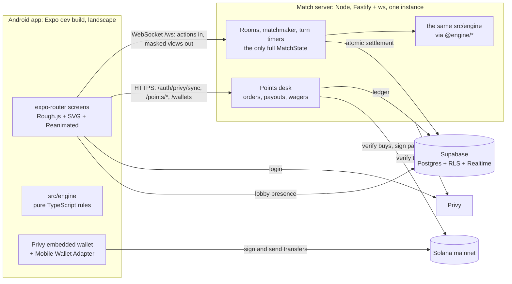

| Concern | Owner |
|---|---|
| Match state, shot resolution, turn timer, board masking | The match server (`server/src/room.ts`) |
| Profiles, ranks, match history, the leaderboard | Supabase Postgres with RLS |
| Lobby presence ("N sailors online") | Supabase Realtime, private channels |
| Offline AI, hot-seat, the tutorial | The phone, running the same engine |
| Points ledger, wagers, SOL exchange | The match server and Postgres functions |
| Login and wallets | Privy; the server verifies |

Some design rules hold everywhere:

- **`reduce()` is the only way state changes.** Actions go in; `{ state, events }` comes out.
  The events are the *animation script*: `src/fx/EventPlayer.ts` plays each one (sound and
  haptics included) before committing it to the screen. The UI never inspects match state to
  decide what to animate.
- **`projectView()` is the whole anti-cheat story.** A player receives their own board in full
  and, of the enemy's board, only what the rules have made public. `server/src/__tests__/leak.test.ts`
  plays full matches and asserts that no unhit enemy ship coordinate ever reaches a client.
- **Deterministic engine.** No `Math.random` and no `Date.now`. Randomness goes through a
  seeded RNG and time is injected, so a match replays exactly from its seed.
- **The wire protocol is frozen.** It's defined in `server/src/protocol.ts`, and
  `src/net/protocol.ts` is a hand-kept mirror. New messages are added; existing ones are never
  repurposed. Every inbound frame is validated with zod.
- **Reconnects are a hard resync**, never an animated replay. The client snaps to the server's
  fresh state, then animates only the events after it.

---

## 🧰 Tech stack

| Layer | Technology |
|---|---|
| App | Expo SDK 57 (development build), React Native 0.86, React 19, TypeScript 6 (strict, `noUncheckedIndexedAccess`) |
| Navigation | expo-router (one native stack) |
| Rendering | react-native-svg + Rough.js (hand-drawn paths), expo-image, Reanimated 4 + Worklets, Gesture Handler |
| State | zustand 5, persisted through `expo-sqlite`'s localStorage shim |
| Validation | zod 4 at every network boundary |
| Audio | expo-audio (a small, quiet player pool) and expo-haptics |
| Auth and wallets | Privy (`@privy-io/expo`), Solana Mobile Wallet Adapter 2, `@solana/web3.js` |
| Server | Node 22+, Fastify 5, `ws`, `@privy-io/node`, `@solana/web3.js` |
| Database | Supabase: Postgres, Row Level Security, Realtime, SQL functions for every money move |
| Tests | Vitest 5, in-process Postgres (PGlite) for migrations, real sockets for netcode |
| Builds | EAS Build (`preview`, `production`, `dapp-store` profiles), Gradle for local sideloads |
| Films | Remotion 4, ffmpeg, Python (numpy, librosa, pedalboard, pyloudnorm) |
| Type | Bitter in the game; Inter Tight and Inter in the launch film |

---

## 📁 File structure

```
battleship-solana-mobile/
├── app/                          expo-router routes: one file per screen
│   ├── _layout.tsx               providers (Privy, fonts), landscape lock, boot gates
│   ├── index.tsx                 boot sequence: paper drops, the grid inks itself
│   ├── menu.tsx                  play online/offline + six tiles
│   ├── (onboarding)/             name · avatar · progress (local vs cloud chooser)
│   ├── (game)/                   placement · searching · battle · reveal · result · hotseat · demo-battle
│   ├── tutorial.tsx · how-to-play.tsx
│   ├── leaderboard.tsx · city.tsx · store.tsx · profile.tsx · settings.tsx
│   ├── points.tsx                points exchange: buy, sell, history
│   ├── wallet.tsx · wallets.tsx  game wallet; linked wallets and the payment wallet
│   └── (dev)/                    kitchen-sink · board-lab (redirect away in release builds)
│
├── src/
│   ├── engine/                   pure rules engine, shared with the server; no RN imports (lint-enforced)
│   │   ├── types.ts              grid, actions, events, TURN_SECONDS, FUEL_BUDGET
│   │   ├── fleet.ts              the 8-ship fleet table
│   │   ├── board.ts · placement.ts   geometry, halos, layout validation, auto-place
│   │   ├── shots.ts              shot resolution, sinking, auto-reveal
│   │   ├── arsenal.ts            the 8 arsenal items, footprints, the aircraft rule
│   │   ├── match.ts              reduce() and projectView()
│   │   ├── ai.ts                 hunt/target AI: easy · normal · hard
│   │   ├── ranks.ts              rank ladder and REWARD
│   │   ├── rng.ts                seeded RNG
│   │   └── __tests__/            rules, simulation and view-leak tests
│   ├── features/                 one folder per feature: arsenal, auth, battle, boot, city, demo,
│   │                             flags, howToPlay, leaderboard, matchmaking, menu, offline,
│   │                             onboarding, points, reveal, store, wallet …
│   ├── board/                    board layout and renderers (GridBoard, DualBoards, ShipSprite)
│   ├── fx/                       EventPlayer, sprite strips, battle effects
│   ├── net/                      Supabase client, match-client (WebSocket), protocol mirror,
│   │                             points API, presence, profile sync
│   ├── state/                    zustand stores: profile, battle, placement, points, locker …
│   ├── wallet/                   Solana helpers and the Mobile Wallet Adapter (Android-only transport)
│   ├── tutorial/                 tutorial script (as data) and overlay
│   ├── ui/                       design system: tokens, <Scale>, useRough, ink components, ArtKeyboard
│   ├── audio/                    music, SFX, the Captain's voice lines, haptics
│   └── util/ · types/
│
├── server/                       authoritative match and points server (its own package)
│   ├── src/
│   │   ├── index.ts              Fastify: /health /ready /auth/privy/sync /points/* /wallets /offline-results
│   │   ├── ws.ts                 socket transport, size and rate limits, violation counting
│   │   ├── protocol.ts           the frozen wire protocol
│   │   ├── matchmaker.ts         queues, rank window, bot fallback, wager holds
│   │   ├── room.ts               one live match: timers, settlement, reveal
│   │   ├── points.ts             buy orders, on-chain verification, treasury payouts
│   │   ├── privy.ts · privySession.ts · auth.ts    identity and sessions
│   │   └── db.ts                 the only reader of the Supabase secret key
│   ├── tests/                    unit · integration (real sockets) · regression
│   ├── scripts/                  seed-demo.ts · verify-rls.ts
│   └── Dockerfile
│
├── supabase/
│   ├── migrations/               0001–0018, numbered and idempotent
│   ├── verify-offline.mjs        runs every migration twice against in-process Postgres
│   └── verify-concurrency.sh     real-Postgres race tests (opt-in)
│
├── tests/                        app test suite; regression/ has one file per shipped bug
├── assets/                       ink line art, colour plates, FX strips, flags, avatars, Port City, audio
├── scripts/                      asset pipelines (ImageMagick, Python), env guard, bundle secret scan, APK signing
├── docs/media/                   screenshots and video posters used by this README
├── launch-film/                  the 1:54 launch film (Remotion), its audio pipeline and deliverables
├── demo-assets/                  raw gameplay captures and the 15 s trailer (battleship-demo-video/)
├── app.json · eas.json           Expo config; EAS profiles: development, preview, production, dapp-store
├── metro.config.js               refuses to bundle if a public env var carries a server secret
├── render.yaml                   the earlier Render blueprint for the server
├── BUG_REPORT.md                 every shipped bug: symptom, cause, fix
└── CLAUDE.md                     the codebase's rules; read before changing code
```

---

## 🚀 Getting started

### Prerequisites

- **Node 22 or newer** and npm. EAS builds pin Node 24.10.0, which wrote `package-lock.json`.
- **Android Studio** with an emulator, or an Android phone with USB debugging.
- Accounts for **Supabase**, **Privy**, and a Solana RPC provider.
- The app needs an **Expo development build**. Privy's native modules don't run in Expo Go.

### 1. Install

```bash
git clone https://github.com/Ayushjhax/battleship-solana-mobile.git
cd battleship-solana-mobile
npm install
cd server && npm install && cd ..
cp .env.example .env              # then fill in the values below
```

### 2. Environment variables

There's one `.env` at the repo root (`.env.example` is the template, and every `.env*` file is
git-ignored). Expo inlines only `EXPO_PUBLIC_*` names into the app; the server reads the rest.

| Name | Read by | Value |
|---|---|---|
| `EXPO_PUBLIC_SUPABASE_URL` | app | `https://<ref>.supabase.co` |
| `EXPO_PUBLIC_SUPABASE_PUBLISHABLE_KEY` | app | `sb_publishable_…` (public by design; RLS protects the data) |
| `EXPO_PUBLIC_WS_URL` | app | `ws://10.0.2.2:8080/ws` on the emulator, `ws://<lan-ip>:8080/ws` on a phone, `wss://<host>/ws` in production |
| `EXPO_PUBLIC_API_URL` | app | Optional HTTP base; otherwise derived from the WebSocket URL |
| `EXPO_PUBLIC_PRIVY_APP_ID` / `EXPO_PUBLIC_PRIVY_CLIENT_ID` | app | Public Privy app ID and mobile client ID |
| `EXPO_PUBLIC_SOLANA_APP_RPC_URL` | app | The app's **own** restricted RPC key. It ships inside the APK, so never reuse the server's |
| `EXPO_PUBLIC_SOLANA_CLUSTER` | app | `mainnet-beta`, `devnet` or `testnet` |
| `SUPABASE_URL` / `SUPABASE_SECRET_KEY` | server | `sb_secret_…` bypasses RLS; only `server/src/db.ts` reads it |
| `PRIVY_APP_ID` / `PRIVY_APP_SECRET` | server | Privy token verification |
| `PRIVY_JWT_VERIFICATION_KEY` | server | Optional verification-key override |
| `SOLANA_RPC_URL` | server | Authenticated RPC for verifying buys and broadcasting payouts |
| `TREASURY_PUBLIC_KEY` / `TREASURY_PRIVATE_KEY` | server | The exchange treasury. The private key is a JSON 64-byte array and must never be committed |
| `SELL_POINTS_COST` / `SELL_SOL_PAYOUT` | server | Must be `100` / `0.001`, the only quote supported |
| `PORT` | server | Default `8080` |

> Metro **refuses to bundle** if a public variable carries a server-only value
> (`scripts/env-guard.cjs`). `npm run check:bundle` exports the Android bundle and fails if a
> server secret appears in it, by value or by shape.

### 3. Database

```bash
npx supabase login
npx supabase link --project-ref <your-project-ref>
npx supabase db push                                                    # applies 0001–0018 in order
npx supabase gen types typescript --linked > src/net/database.types.ts
```

Then, in the Supabase dashboard, go to **Realtime → Settings** and turn **off** "Allow public
access". The schema and what each table enforces are described in
[supabase/README.md](supabase/README.md).

In the Privy dashboard:

- enable **Email**, **Google** and **Wallet** login, with **Solana** for wallets
- create a native mobile app client and allow the `empireofbits` app scheme
- enable **Solana embedded wallets**
- allow the Sign In With Solana domain. This repo uses `empireofbits.xyz`, set as
  `APP_DOMAIN` in `src/wallet/mwaCore.ts`; a fork should change it to its own domain.

The server reports which Solana cluster its RPC serves, and the app refuses to pay when that
differs from `EXPO_PUBLIC_SOLANA_CLUSTER`.

### 4. Run

```bash
npm run server            # match server: http://localhost:8080/health · ws://localhost:8080/ws
npm run android           # first time: build and install the dev client, start Metro
npm run android:metro     # later JS-only sessions, using the installed dev client
```

Optional: seed a crew, match history and a mid-ladder rank for demos with
`cd server && npm run seed:demo -- <your-user-id>`. Five taps on the menu's version number
open the demo menu, which shows your user ID.

---

## ✅ Tests and checks

| Command | What it proves |
|---|---|
| `npm run typecheck` | The app compiles under strict TypeScript |
| `npm test` | The app suite (844 tests in 76 files): engine rules, AI, placement, the battle store, the match client over real sockets against a fake server running the real engine, wallet flows, regressions |
| `npm run lint` | ESLint, including the **engine-purity rule** |
| `npx expo-doctor` | Expo dependency health |
| `npm --prefix server run typecheck && npm --prefix server test` | The server suite (196 tests in 25 files), including the **board-leak test** |
| `node supabase/verify-offline.mjs` | Every migration, run twice, against an in-process Postgres |
| `npm run check:bundle` | No server secret in the shipped JavaScript bundle |
| `NODE_OPTIONS=--expose-gc SOAK_MATCHES=25 npx vitest run tests/perf` | Many matches in one session, with nothing accumulating |

`tests/regression/` is the convention that matters. Every file there exists because a bug
reached a player. Its header says what the player saw, then what caused it. The full log is in
[BUG_REPORT.md](BUG_REPORT.md).

---

## 📦 Deployment and releases

### The match server

Production runs as **one** always-on AWS EC2 instance behind `api.empireofbits.xyz`.
`server/Dockerfile` builds it anywhere. The build context must be the repo root, because the
server imports `src/engine`. `render.yaml` is the earlier Render blueprint, kept for reference.

- **Never run two instances or autoscale.** Rooms and queues live in process memory, so a
  second instance would never see the first one's matches.
- `GET /health` returns `{ ok, rooms, queued, uptime }`. `GET /ready` checks that the
  database schema the server needs is in place.
- Apply new migrations **before** deploying a server that uses them.
- Use `wss://` for anything off your LAN: the `hello` message carries an access token.

### The Android app

| Build | Command |
|---|---|
| Dev client | `npx expo run:android` |
| Sideload APK (arm64) | `cd android && ./gradlew assembleRelease -PreactNativeArchitectures=arm64-v8a` (`android/` is generated by the first `expo run:android`) |
| EAS preview APK | `npm run eas:apk` |
| Play Store AAB | `npm run eas:aab` |
| Solana dApp Store APK | `npx eas-cli build -p android --profile dapp-store`, then `bash scripts/sign-dapp-store-apk.sh <apk> <out>` |

Bundle ID `com.empireofbits.seabattle`, scheme `empireofbits`, minimum SDK 28 (Android 9).
dApp Store builds are re-signed locally with the release key, using a v3 signing lineage
from the old debug key, so earlier sideloads update in place. The release key never goes to
EAS or into this repo. The header of `scripts/sign-dapp-store-apk.sh` lists the files the
script expects and where it looks for them. Every release must raise both `version` and
`versionCode` in `app.json`.

---

## 🔐 Security model

- **Hidden information stays hidden.** The server owns both boards. Clients receive only
  `projectView()` output, and a test proves it across whole matches.
- **The server referees every action.** Each action goes through the same `reduce()`. A
  rejected action is never applied, and five illegal actions disconnect the socket. Messages
  are capped at 16 KB and 10 per second.
- **Clients can't write scores.** A database trigger rejects any score write that carries a
  user JWT. Only the server, with the secret key, settles results.
- **Money moves only in SQL functions.** They are idempotent and keyed by request ID, run on
  an append-only ledger, and treat signatures as single-use.
- **Secrets never ship.** `env-guard.cjs` makes Metro refuse to bundle a leaked value,
  `check:bundle` scans the output, and `.easignore` keeps `.env*` files, keystores and
  `server/` out of EAS uploads (`tests/tooling/easignore.test.ts`).
- **No auto-signing.** The app holds no private keys. Every wallet request is approved in the
  wallet app.

Found a vulnerability? Please report it privately to the maintainer rather than opening a
public issue.

---

## 📚 Documentation map

| Document | What's in it |
|---|---|
| [CLAUDE.md](CLAUDE.md) | The rules of the codebase: engine purity, the canvas, tokens, the battle, online play, results, the store |
| [supabase/README.md](supabase/README.md) | Schema, RLS, and what each table enforces |
| [tests/README.md](tests/README.md) | How the suites are laid out and what is faked |
| [BUG_REPORT.md](BUG_REPORT.md) | The audit log of shipped bugs |
| [launch-film/](launch-film/) | BRIEF, STORYBOARD, EDIT_NOTES, REVIEW, FOOTAGE_LOG |
| [demo-assets/battleship-demo-video/](demo-assets/battleship-demo-video/README.md) | The trailer's Remotion project |

Source comments still cite sections of the original design brief (for example "brief 3.3").
Those rules are the ones written out under [How to play](#-how-to-play) above, and the
engine module named in each comment holds the authoritative version.

### Known limitations

- **Android is the tested target.** The Privy configuration supports iOS, but no iOS build is
  tested. Web isn't supported by this app.
- **Landscape only**, on every screen.
- **One match server instance.** A restart ends the matches in progress.
- **The Port City is a preview**, store editions don't change gameplay, and gems aren't used
  yet.
- **External-wallet (MWA) purchases** are covered by tests, but have had less testing on real
  devices than the embedded wallet.

---

## 🤝 Contributing

Empire of Bits is open source, and contributions are welcome: bug fixes, AI improvements, new
tests, documentation, art pipelines.

1. **Read [CLAUDE.md](CLAUDE.md) first.** It's short and holds the rules that keep the game
   correct.
2. Fork, then create a branch from `master`.
3. Make your change, with a test. A bug fix gets a file in `tests/regression/` (or
   `server/tests/regression/`) named after the symptom.
4. Run the checks: `npm run typecheck && npm test && npm run lint`, plus the server suite if
   you touched `server/` or `src/engine/`.
5. Open a pull request that says what changed, why, and how you verified it.

The rules that matter most:

- **`src/engine/` stays pure.** No `react`, `react-native` or `expo-*` imports, no
  `Math.random`, no `Date.now`. The server runs this exact code.
- **A rule change is an engine change**, and it ships with the server. If you change which
  arsenal item is planted versus carried, deploy the server together with the APK.
- **Never repurpose a protocol message.** Add a new one, and update both `server/src/protocol.ts`
  and `src/net/protocol.ts`.
- **Lay out on the 800×360 canvas** inside `<Scale>`. No percentages, `Dimensions` maths or
  breakpoints.
- **Use design tokens, never raw hex.** Borders and panels come from `useRough()` with a seed
  from `hashString('stable-key')`.
- **No endless animation** on any screen a match lives on (a test enforces this).
- **Nothing secret in `EXPO_PUBLIC_*`.**

---

## 📄 License and credits

Released under the [MIT License](LICENSE). © 2026 Ayush Jha.

- The rules follow the classic pen-and-paper game and the house rules of *Ocean Warfare 2*
  by BYRIL. Game mechanics aren't copyrightable; this project ships under its own name and
  look.
- Fonts: [Bitter](https://fonts.google.com/specimen/Bitter), Fredoka, Inter, Inter Tight and
  Patrick Hand, all under the SIL Open Font License.
- Hand-drawn rendering by [Rough.js](https://roughjs.com/) (MIT).
- Third-party packages keep their own licenses. See `package.json`, `server/package.json`,
  `launch-film/package.json` and `demo-assets/battleship-demo-video/package.json`.

<div align="center">

**Every empire starts with a single bit.** Your move.

</div>
